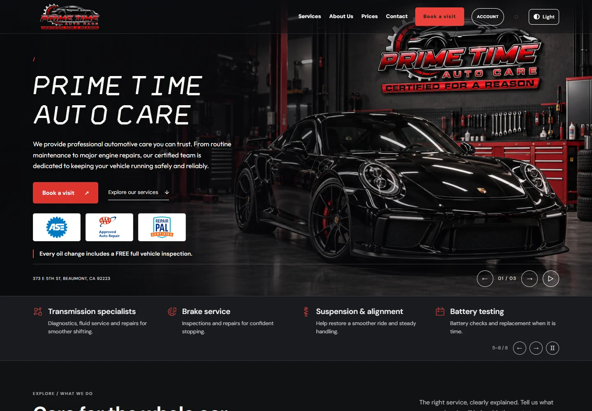
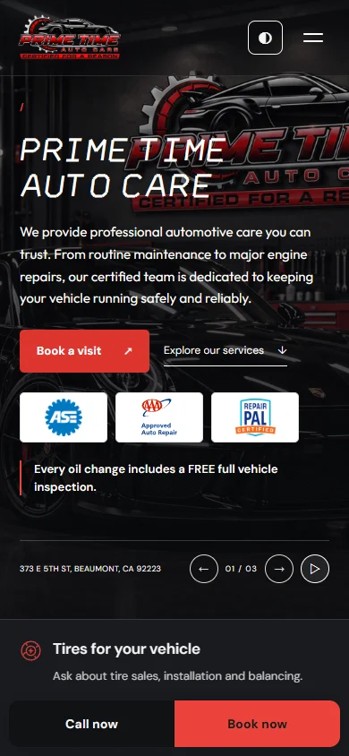
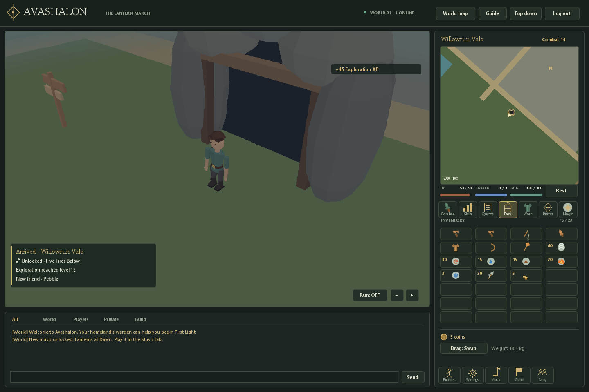
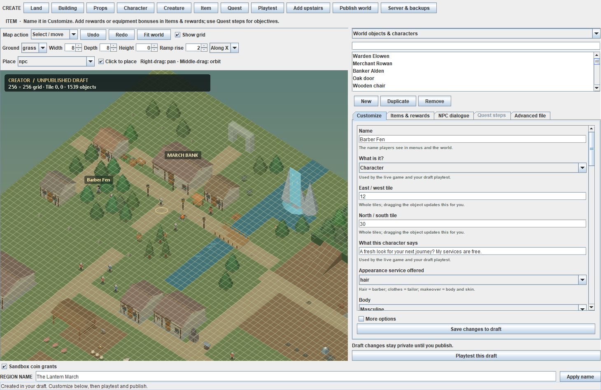
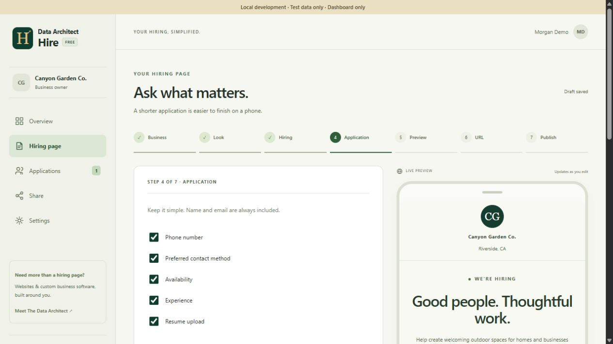

# Shayne Brown — Software Portfolio

### From business workflows to multiplayer worlds.

A collection of software I’ve built: website tools, educational games, multiplayer worlds and their editors, warehouse operations, mobile business research, and hiring workflows. Each project shows a different part of turning an idea into a usable system.

[GitHub profile](https://github.com/e36shayne) · [Data Architect — my website](https://dataarchitectpro.com/) · [Contact](https://dataarchitectpro.com/contact)

## Explore the projects

| Project | Purpose | Platform |
| --- | --- | --- |
| [Math Kingdom](#math-kingdom) | Teach and practice foundational math through dragon adventures for grades K–4 | Responsive browser game with parent accounts |
| [WDM](#wdm--web-design-machine) | Build, edit, and publish business websites | Desktop-hosted web app + cloud services |
| [Prime Time Certified](#prime-time-certified) | An automotive website with service discovery and appointment requests | Responsive website on Cloudflare Pages |
| [Manifest](#manifest-card-game) | Card battles, player progression, and card creation | Browser + Node.js server |
| [Avashalon + Creator](#avashalon-and-creator) | An online RPG and the tools used to author its world | Java desktop client, server, and editor |
| [Pallit](#pallit) | Inventory, people, and warehouse operations | Desktop and mobile browsers on a local network |
| [Finder Local](#finder-local--desktop-and-android) | Research local businesses and organize prospects | Desktop app + separate Android app |
| [Hire](#data-architect-hire) | Publish applications and manage hiring responses | Hosted web app |

## Math Kingdom

**A free math learning game for children in kindergarten through fourth grade.**

Math Kingdom turns addition, subtraction, multiplication, and division into dragon adventures. It started with a practical goal: make multiplication easier to understand and give children a reason to keep practicing. Short, interactive lessons lead into exploration, flying challenges, platforming, and boss battles.

**[Play Math Kingdom →](https://playmathkingdom.pages.dev/)**

[Read the codebase walkthrough →](mathkingdom-codebase.md) — JavaScript, HTML/CSS, SVG animation, game physics, accounts, saves, and deployment.

- **Teaching before practice:** concrete stories, pictures, step-by-step calculations, optional read-aloud, and examples that update together when a learner tries a different number.
- **Three ways to play:** build a Treasure Trail, fly and shoot answer targets in Sky Flight, or run and jump through math doors in Dragon Jump. Each completed qualifying round leads to a boss battle.
- **Progress with a purpose:** sequential worlds, gems earned through play, dragon accessories, and fire, ice, and lightning upgrades. Math questions are untimed, with hints and retries available.
- **Parent-managed saves:** email-link sign-in, separate learner profiles, progress tracking, and saves across devices. Guest play is also available.
- **Designed for touch and keyboard:** responsive phone, tablet, and desktop layouts, enlarged touch controls, and independent movement, jump, and fire inputs.
- **Original presentation:** animated SVG dragons and bosses, selectable color themes, sound effects, and reduced-motion support.

**Current learning range:** addition with totals through 20, subtraction with positive answers through 10, multiplication tables 1–10, and exact division with divisors and answers 1–10. K–4 is the intended audience; this release focuses on foundational arithmetic rather than a complete grade-by-grade curriculum.

**Roadmap:**

- Extend the multiplication tables and adventure map through 11s and 12s.
- Follow with multi-digit arithmetic, clear place-value explanations, and worked examples.
- Expand dragon customization so children have more ways to make their companion their own.

These additions are planned for future releases.

**Engineering focus:** connecting understandable lessons to game rules, smooth multi-touch controls, per-learner progress, secure parent sessions, and repeatable deployments. The November 2026 control update passed 45 automated tests covering arithmetic, progression, account access, saves, input handling, platform physics, and WDM integration, alongside browser checks at phone and tablet sizes.

**Stack:** JavaScript, HTML/CSS, SVG, Node.js tooling, Cloudflare Pages/Workers, D1, Brevo transactional email, and WDM publishing.

**Status:** Live and free to play, with no real-money purchases. Actively improved through hands-on playtesting and parent feedback. This entry showcases the product; application source is maintained separately.

## WDM — Web Design Machine

**A website-building workspace that connects design, content, and publishing.**

WDM brings reusable business templates, visual page controls, saved projects, and deployment into one local application. Its hosted components support client editing and business records after a site goes live.

- Generate business-specific pages from reusable templates.
- Edit content, section order, typography, links, and images visually.
- Give clients access to their assigned sites and persist their changes.
- Support inquiries, bookings, work orders, and catalog-order workflows.
- Publish through Cloudflare tooling.

**Engineering focus:** connecting the editing experience to persistent content and a deliberate publishing workflow.

**Stack:** JavaScript, Node.js, HTML/CSS, Cloudflare Workers/Pages, D1.

**Status:** Working local application with hosted components. This is a project showcase; the application source is not released here.

[Explore website examples](https://dataarchitectpro.com/work) · [Read about visual editing](https://dataarchitectpro.com/blog/custom-cms-visual-editor-workflow)

## Prime Time Certified

**An automotive website that connects a distinctive visual identity to practical customer actions.**

Built for Prime Time Auto Care in Beaumont, the site brings service information, vehicle intake, appointment requests, and contact details into one responsive experience. It is a public example of the websites I build with WDM.

See the mobile layout

*Desktop and mobile captures from the site's October 2026 portfolio gallery.*

- Automotive branding, a photographic hero, service carousels, and light/dark appearance controls.
- Service and tire catalogs with a cart for planning a request.
- Vehicle-detail intake and preferred appointment dates/times, subject to shop confirmation.
- Mobile navigation, tap-to-call links, business hours, and directions.
- Dedicated service, pricing, about, contact, and booking pages.

**Design and engineering focus:** carrying a consistent brand across screen sizes while making it easy to move from browsing services to contacting the shop.

**Stack:** HTML, CSS, JavaScript, WDM, Cloudflare Pages.

**Status:** Live public website. Service requests, availability, fitment, and final pricing are confirmed by the shop.

**[Visit Prime Time Certified →](https://primetimecertified.pages.dev/)**

## Manifest Card Game

**A card-game project with play, creation, progression, and update management.**

Manifest includes a battle room, guided first-battle onboarding, scripted solo scenarios, and card-creation tools. Player accounts and progression persist behind the browser interface.

- Shared battle interactions for tutorial and solo flows.
- Card identities and previews used across creation, collections, and gameplay.
- Server-backed solo runs and reward records.
- A desktop manager with separate test and live environments.
- Update publishing designed to preserve player data and let active games finish.

**Engineering focus:** consistent game rules across interfaces, persistent player state, and controlled releases.

**Stack:** JavaScript, Node.js, SQLite, Cloudflare Tunnel.

**Status:** Playable development project. Public availability depends on the host being online; real-money purchases are disabled.

## Avashalon and Creator

**An online RPG and a custom engine/editor toolchain for building its world.**

Avashalon combines a Java game client, an authoritative server, persistent characters, and a separate Creator application. The game includes exploration, gathering, combat, equipment, quests, and shared player interactions.

*Development screenshot from the project’s existing preview gallery.*

### The game

- Persistent accounts and characters, inventory, equipment, and progression.
- Server-controlled movement, combat, interactions, and shared world state.
- Low-poly environments, character customization, and game interface systems.
- A simplified mobile/browser client experiment alongside the desktop game.

### The Creator

The Creator is the authoring side of the project: build a world, playtest a draft, then publish it to the server.

*Development screenshot showing world placement and character authoring.*

- Terrain, object and path painting, world-object search, and camera framing.
- Structures, reusable blueprints, duplication, and rotation.
- Characters, items, dialogue, quest steps, and low-poly model authoring.
- Draft playtesting and validated world publishing with backups and content revisions.

**Engineering focus:** keeping the game, saved player state, and authoring tools connected while giving draft content its own workflow.

**Stack:** Java desktop client, Java server, custom Creator tools, browser-client experiment.

**Status:** Online RPG prototype; development is currently on hiatus. The browser experiment is a simplified client, and the Creator is an internal authoring tool.

## Pallit

**A local warehouse workspace for keeping the floor, the stock, and the team in sync.**

Pallit runs from one host computer and stores its records in SQLite. Desktop, tablet, and phone browsers can connect over the same trusted network.

- Inventory receipts, transfers, shipments, counts, lot references, and movement history.
- Storage zones, pallet capacity, and a warehouse planning grid.
- Teams, employee records, tasks, gate/yard check-in, and department handoffs.
- Outbound stock reservations and configurable order stages.
- Custom permissions, time approval, payroll preparation, and basic bookkeeping.
- CSV import/export, Excel workbooks, and database snapshots.

**Engineering focus:** atomic inventory changes, permission-scoped records, and usable workflows across desktop and mobile screens.

**Stack:** Node.js 24, SQLite, HTML/CSS, browser JavaScript; no third-party runtime dependencies.

**Status:** Local version 0.2.0. Payroll prepares reviewed records; it does not calculate jurisdiction-specific taxes or transfer money. Intended for trusted local networks.

## Finder Local — Desktop and Android

**Local business research with a persistent prospect pipeline.**

The finder reviews public business profiles for website information and organizes the results for follow-up. A missing website link is a research signal, not proof that the business has no website.

### Desktop application

- Search by business type and city/ZIP using a visible Chrome or Edge research window.
- Save businesses, notes, and pipeline stages such as approached, follow-up, and interested.
- Filter saved prospects and export CSV.
- Use a paired mobile dashboard on the same Wi-Fi network.

### Separate Android application

- A native Java shell with packaged HTML/CSS/JavaScript and on-device research.
- Local history, call-tap tracking, follow-up dates, and do-not-call records.
- JSON backup/import, including desktop history imports.
- Separate app and research WebViews, with manual handling of verification prompts.

**Engineering focus:** useful research records that survive restarts, portable history, and interfaces suited to both a desk and a phone.

**Stack:** Desktop Node.js and browser JavaScript; Android Java, WebView, and local file storage.

**Status:** Desktop app plus a built and signed Android package. The Android build’s documented verification still calls for an initial physical-device check.

[Android project/download page](https://finderlocal.pages.dev/)

## Data Architect Hire

**A hiring-page builder with a practical applicant dashboard.**

Hire lets a business build a branded application page, choose its questions, publish a shareable link, and review responses and resumes in one place.

*Walkthrough screenshot using a fictional business and demonstration data.*

- Configurable hiring pages and application questions.
- Resume uploads, applicant statuses, and team notes.
- Business-scoped access to applications and attachments.
- Draft/publish controls and stable application links.
- Account recovery and administrative support workflows.

**Engineering focus:** a clear application experience for candidates and organized, business-specific records for the people hiring.

**Stack:** JavaScript, Cloudflare Workers, D1, R2.

**Status:** Public web application. Employers handle applicant outreach and hiring decisions.

[Open Hire](https://hire.dataarchitectpro.com/) · [Read the product walkthrough](https://dataarchitectpro.com/blog/free-online-job-application-creator)

## Build walkthroughs

I publish longer explanations on the Data Architect blog. These articles show how the interface, stored data, and business workflow connect.

- **[Building the hiring flow](https://dataarchitectpro.com/blog/free-online-job-application-creator)** — branded pages, application forms, and applicant review.
- **[Inside the visual CMS](https://dataarchitectpro.com/blog/custom-cms-visual-editor-workflow)** — editing, drafts, publishing, and shared website content.
- **[From inquiry to agreement and payment](https://dataarchitectpro.com/blog/business-inquiry-payment-workflow)** — connecting the stages of a service-business workflow.

## Approach

I combine product direction, interface design, AI-assisted development, hands-on review, and iterative testing. These projects reflect a recurring interest: building the tools around the main experience, including editors, admin screens, persistence, and update workflows.

This repository is a curated showcase with project descriptions and selected screenshots. Release status is stated per project; application source releases are separate from this portfolio. Screenshots are development, demonstration, or public website captures, not customer records.

[Discuss a project](https://dataarchitectpro.com/contact) · [Visit Data Architect](https://dataarchitectpro.com/)
