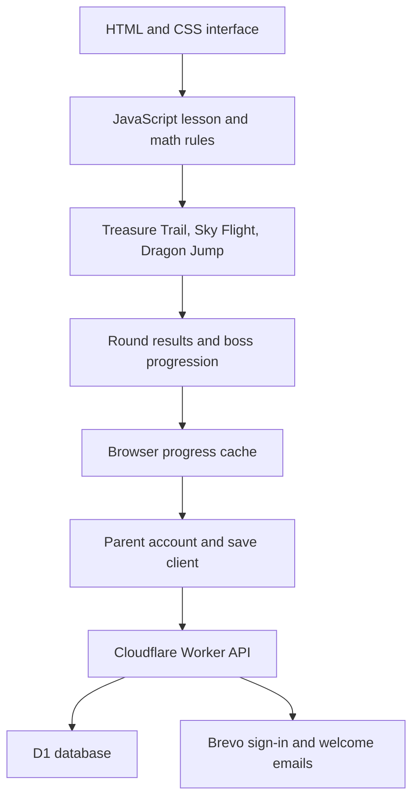

# Inside Math Kingdom

**JavaScript, HTML, CSS, and SVG power a browser math adventure for grades K–4.**

[Play the game](https://playmathkingdom.pages.dev/) · [Project showcase](README.md#math-kingdom) · [Shayne Brown / Data Architect](https://dataarchitectpro.com/)

Math Kingdom connects interactive arithmetic lessons to three game modes, dragon companions, boss battles, and parent-managed progress. This walkthrough describes the November 2026 implementation. The source is maintained in its WDM project; this portfolio contains documentation and selected public screenshots.

## What each technology does

| Technology | Its job in Math Kingdom |
| --- | --- |
| **HTML** | Structures navigation, lesson dialogs, questions, buttons, family settings, and the game interface. |
| **CSS** | Controls typography, themes, responsive layouts, character animation, effects, and touch-target sizes. |
| **JavaScript** | Generates problems, checks answers, runs game rules and movement, updates the interface, plays sounds, and coordinates saves. |
| **SVG** | Draws the original dragons, bosses, and other vector artwork. |
| **Cloudflare Pages + Workers** | Serves the game and runs the JavaScript account/progress API. |
| **D1 + SQL** | Stores parent accounts, learner profiles, progress, sessions, and temporary activity records. D1 uses SQLite semantics. |
| **Brevo** | Delivers parent sign-in links and welcome emails. |
| **Node.js, esbuild, and Wrangler** | Run tests, build the server bundle, preview locally, and publish updates. WDM manages the project and publishing integration. |

The frontend uses plain JavaScript with HTML elements and SVG artwork. The browser executes movement and gameplay locally; account and cloud-save requests go to the Worker.

## What SVG means

**SVG stands for Scalable Vector Graphics.** An SVG picture is described with shapes, lines, curves, and colors. It stays sharp as it grows or shrinks because the browser redraws those shapes at the requested size.

In Math Kingdom, a dragon is made from separate illustrated parts. Its eyes can close, wings can flap, and tail can move. CSS animations and JavaScript-controlled states give it idle, walking, flying, waving, and attack poses. The same artwork can work on a small phone and a larger tablet. Reduced-motion settings turn off continuous animation.

## How the parts connect

Lessons and gameplay share arithmetic rules. A lesson can explain a problem, show a picture, and let the learner change a number; the explanation and picture update together. Game modes then use those problems as part of play. Progress is tracked separately for each subject, while gems and cosmetics belong to the learner.

## Source map

These paths describe the application project, not files included in this showcase repository. In this project, `dist/` contains editable frontend sources as well as generated deployment files.

| Module or folder | Responsibility |
| --- | --- |
| `dist/index.html`, `styles.css`, and feature stylesheets | Application shell, script loading, layout, themes, and responsive presentation. |
| `dist/learning.js` | Arithmetic, answer choices, problem sets, progress normalization, world unlocking, and boss rules. The Worker also uses its save-normalization logic. |
| `dist/teaching.js` | Concrete stories, explanations of symbols, worked calculations, and teaching steps. |
| `dist/lesson-guide.js` | Interactive lesson display, counting pictures, changing examples, and parent prompts. |
| `dist/app.js` | Core views, game state, question handling, rewards, browser saving, and synthesized sound effects. |
| `dist/expansion.js`, `adventure-final.js` | Subject selection, landing/game enhancements, flight controls, target challenges, and presentation refinements. |
| `dist/platformer-engine.js` | Course generation, player physics, collisions, enemies, projectiles, gems, math gates, and the finish bonus. |
| `dist/platformer.js` | Connects platform physics to the rendered course, keyboard input, and multi-touch controls. |
| `dist/progression.js` | Connects qualifying rounds, boss attempts, retries, celebrations, and world completion. |
| `dist/dragon-motion.js`, `action-dragons.js`, `page-motion.js` | Character poses, SVG artwork, boss visuals, and page transitions. |
| `dist/accounts.js` | Parent sign-in, learner switching, pending saves, cloud synchronization, and conflict recovery. |
| `dist/presence.js` | Short-lived activity signals for the private owner dashboard. |
| `src/worker.mjs`, `db/schema.sql` | Account API, authorization, email delivery, database queries, and schema. |
| `scripts/build.cjs`, `server.cjs`, `tests/` | Worker bundling, local static preview, and automated verification. |

The frontend currently loads ordered, deferred scripts. Several feature modules extend shared rendering functions, so script order matters. The math rules and platform physics are separated from rendering to make their behavior easier to test.

## Gameplay and input

**Treasure Trail** turns correct answers into progress along a path. **Sky Flight** combines math answers with dragon movement and a separate timed target bonus. **Dragon Jump** uses a continuous platform course with enemies, breath attacks, and math doors.

Dragon Jump advances through a `requestAnimationFrame` loop. The physics engine receives elapsed time and the currently held actions, then returns events such as collecting a gem, reaching a door, or landing on an enemy. The UI responds with updated artwork, sounds, and rewards.

Touch input tracks each finger by its pointer ID. A child can hold a direction while tapping jump and fire. Releases and cancellations affect the relevant finger, and the persistent game container keeps handling releases when controls are redrawn. Interrupted touches are cleared when focus or visibility changes. Buttons grow for touch screens, and keyboard controls remain available.

## Progress and parent accounts

Guest progress stays in the current browser. A parent can sign in with a single-use email link, create separate learner profiles, and save progress across devices. Children use nicknames; the game does not ask them for an email address.

The Worker checks the parent session and ownership before accessing a profile. Sign-in and session tokens are stored as hashes; production sessions use secure HttpOnly cookies. The API uses parameterized SQL, same-origin checks for changes, rate limits, and bounded save normalization.

Cloud saves include a revision number. If another device has already saved a newer revision, the API reports a conflict instead of silently overwriting it. The interface offers a backup and a deliberate choice to load the cloud save. Local pending progress is kept while a save is waiting for a connection.

The private owner view reports signups and recent activity. “Online” reflects recent activity signals, not an exact live connection count. These records expire; they do not contain learner answers.

## Testing and publishing

The November 7, 2026 release passed **45 automated tests** using Node's test runner. Coverage includes arithmetic and answer choices, teaching-model consistency, subject-specific progress, sequential unlocking, boss retries, account ownership, email-link behavior, save conflicts, flight controls, platform physics, multi-touch handling, and WDM integration. Browser checks also covered phone and tablet layouts; those checks are distinct from physical iPad playtesting.

The build uses esbuild to bundle the Worker and generates route and security-header files. WDM preserves the custom game sources and publishes the frontend plus API to Cloudflare Pages. Production secrets are configured separately from public assets.

## What comes next

- Multiplication tables and adventure worlds for 11s and 12s.
- Multi-digit arithmetic with place-value teaching and worked examples.
- More dragon customization and cosmetic choices for children.

K–4 describes the intended audience. The current release teaches and practices foundational arithmetic; it is not a complete grade-by-grade curriculum. New work can be tested in a separate preview before it reaches the public game.
